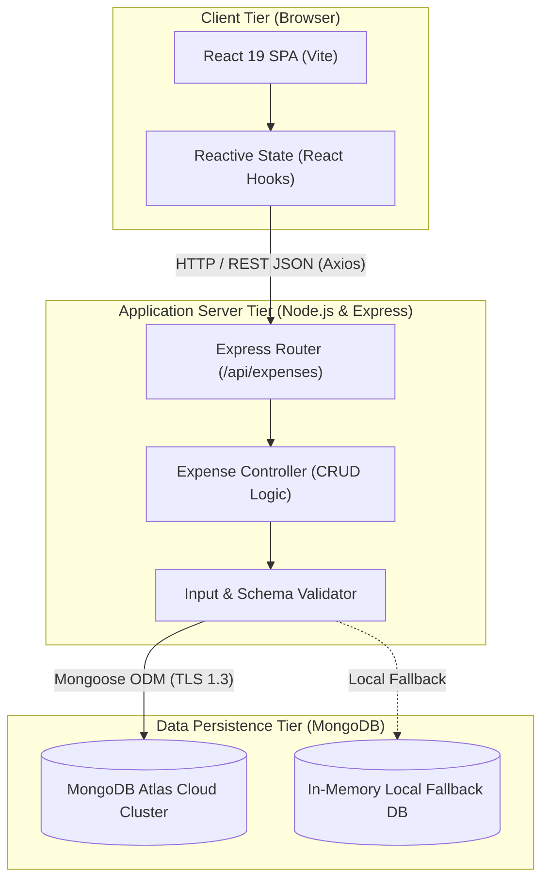

# SOFTWARE REQUIREMENTS SPECIFICATION (SRS)
## Personal Expense Tracker (MERN Stack Architecture)

**Organization:** Information & Communication Technology Academy of Kerala (ICTAK)  
**Program:** Full Stack Application Development with ReactJS (Summer Internship)  
**Project Title:** Personal Expense Tracker Web Application  
**Author / Intern:** Hains (Student Intern)  
**Institution:** Sahrdaya College of Engineering & Technology, Thrissur (Autonomous) / ICTAK  
**Academic Year:** 2026  
**Document Version:** 1.0.0  
**Date of Submission:** October 2026  

---

## 1. Introduction

### 1.1 Purpose
The purpose of this Software Requirements Specification (SRS) document is to establish a comprehensive technical and functional baseline for the **Personal Expense Tracker** web application. This document specifies the functional requirements, external interface requirements, performance characteristics, data models, design constraints, and quality attributes necessary for the development, verification, and deployment of the application under the ICT Academy of Kerala (ICTAK) MERN Stack curriculum.

### 1.2 Scope of the System
The **Personal Expense Tracker** is a production-grade 3-tier web application built on the **MERN** technology stack (**MongoDB Atlas**, **Express.js**, **React.js 19**, and **Node.js**). The system addresses common challenges in personal financial management by replacing error-prone manual logs and static spreadsheets with an interactive, responsive, cloud-backed single-page application (SPA).

**Key Capabilities:**
- End-to-end CRUD operations (Create, Read, Update, Delete) for daily personal expense entries.
- Real-time reactive state synchronization: dynamic recalculation of **Total Amount Spent** and category expenditure distributions without page refreshes.
- Strict multi-tier validation (client-side form guards and server-side Mongoose schema validation) to prevent erroneous or negative entries.
- Category classification (`Food`, `Transportation`, `Entertainment`, `Utilities`, `Healthcare`, `Shopping`, `Other`) with visual color-coded badges.
- Confirmation modal safeguards prior to destructive actions (permanent deletion).
- Cloud persistence on **MongoDB Atlas** with zero-configuration fallback to an in-memory database engine for evaluation.

### 1.3 Document Conventions
- **Shall / Must:** Mandatory functional or non-functional requirement.
- **Should:** Highly recommended design standard.
- **May:** Optional feature planned for future iterations.
- Requirements identifiers follow standard taxonomy:
  - `FR-x`: Functional Requirement number $x$
  - `NFR-x`: Non-Functional Requirement number $x$
  - `IR-x`: Interface Requirement number $x$

### 1.4 Intended Audience & Reading Suggestions
This document is prepared for:
1. **Academic Evaluators & ICTAK Mentors:** For evaluating compliance with full-stack software engineering standards and project criteria.
2. **Software Developers & Reviewers:** For architectural understanding, API contract verification, and repository evaluation.
3. **Quality Assurance Testers:** For executing test cases against specified acceptance criteria.

### 1.5 References & Industry Standards
1. *IEEE Std 830-1998*: IEEE Recommended Practice for Software Requirements Specifications.
2. *ICT Academy of Kerala (ICTAK)*: Student Reference Guide - MERN Stack Project Guidelines.
3. *React Documentation*: https://react.dev/
4. *Express.js Security Best Practices*: https://expressjs.com/en/advanced/best-practice-security.html
5. *MongoDB Atlas Documentation*: https://www.mongodb.com/docs/atlas/

---

## 2. Overall Description

### 2.1 Product Perspective
The Personal Expense Tracker operates in a client-server distributed architecture. The user interface executes within modern client web browsers as a compiled React Single Page Application. HTTP/JSON requests are transmitted across RESTful endpoints to a Node.js/Express.js application server. The application server processes business logic, validates payloads, and interfaces with MongoDB Atlas over an encrypted TLS connection via Mongoose ODM.



### 2.2 Product Functions (High-Level Summary)
1. **Expense Creation:** Record expenses with title, numerical amount (positive), category selection, transaction date, and optional notes.
2. **Directory & Filter Display:** Render all recorded expenses in descending chronological order with category filtering and visual badges.
3. **Automated Expenditure Aggregation:** Calculate and display the sum total of all filtered and unfiltered expenditures dynamically.
4. **Expense Modification:** Pre-fill form fields with existing records, enabling instant updates with server-side reconciliation.
5. **Safe Expense Removal:** Provide an interactive modal dialog to confirm or cancel deletion operations.
6. **Data Integrity & Feedback:** Return immediate visual toast notifications for success, warning, or error states.

### 2.3 User Classes and Characteristics
- **Standard User (Self-Service):** General computer/mobile device user seeking to manage daily expenditure. Requires an intuitive, zero-training interface with instant visual feedback, clear error alerts, and responsive layout across desktops, tablets, and smartphones.
- **Evaluator / Administrator:** Technical reviewer verifying API contracts, database persistence, status codes, and code separation of concerns.

### 2.4 Operating Environment
- **Client Runtime:** Modern web browsers supporting ECMAScript 2020+ (Google Chrome 90+, Mozilla Firefox 88+, Safari 14+, Microsoft Edge 90+).
- **Server Runtime:** Node.js version 18.x or 20.x LTS on Windows, Linux, or macOS.
- **Database Engine:** MongoDB 6.0+ / MongoDB Atlas Cloud Cluster with Mongoose ODM 8.x / 9.x.
- **Hosting Environments:** Vercel / Netlify for Static Frontend, Render / Railway for Node.js API.

### 2.5 Design and Implementation Constraints
1. **Architectural Separation:** Strict decoupling between presentation components, API services, Express controllers, and Mongoose models.
2. **Zero Plaintext Secrets:** All sensitive credentials (database URI, port, environment modes) must reside exclusively in `.env` files, with `.env.example` committed to version control.
3. **Cross-Origin Resource Sharing (CORS):** Backend must safely permit authorized frontend origins while safeguarding against unauthorized access.
4. **Mobile Responsiveness:** Viewports ranging from 360px (mobile) to 1920px (full HD) must render without horizontal layout clipping.

---

## 3. System Features & Functional Requirements

### 3.1 Feature 1: Record New Expense (Create)
- **Description:** Enables users to submit and persist a new financial transaction into MongoDB Atlas.
- **Inputs:** `title` (String), `amount` (Number), `category` (Enum String), `date` (Date), `notes` (String, optional).
- **Processing Logic:** 
  1. Frontend validates that title is non-empty, amount is greater than 0, and category is selected.
  2. Submits `POST /api/expenses` with JSON payload.
  3. Controller performs secondary validation and passes payload to `Expense.create()`.
  4. Server responds with HTTP `201 Created` and the new document.
  5. React updates local state and recalculates total amount spent reactively.

#### Specific Requirements:
- `FR-1.1`: The system **shall** reject any submission where title consists solely of whitespace.
- `FR-1.2`: The system **shall** reject any transaction where amount is $\le 0$.
- `FR-1.3`: The system **shall** default the transaction date to the current date if omitted.
- `FR-1.4`: The system **shall** support the following predefined categories: *Food, Transportation, Entertainment, Utilities, Healthcare, Shopping, Other*.

### 3.2 Feature 2: Expense List & Category Filtering (Read)
- **Description:** Retrieves and displays all expense records in a clear tabular and card layout with filtering capabilities.
- **Inputs:** Optional query parameter `?category=<CategoryName>`.
- **Processing Logic:**
  1. Frontend triggers `GET /api/expenses` on mount.
  2. Server queries MongoDB with sort order `{ date: -1, createdAt: -1 }`.
  3. Returns HTTP `200 OK` with JSON array of expense records and summary statistics.
  4. If user selects a category pill, frontend filters view and updates category subtotal immediately.

#### Specific Requirements:
- `FR-2.1`: The system **shall** display an informative "Empty State" message when zero transactions are logged.
- `FR-2.2`: The system **shall** display distinct color-coded badges for each category.
- `FR-2.3`: The system **shall** support single-click filtering by category.

### 3.3 Feature 3: Expense Modification (Update)
- **Description:** Allows modification of an existing expense without requiring deletion and re-creation.
- **Inputs:** Expense `_id` via URL parameter (`/api/expenses/:id`) and updated fields in request body.
- **Processing Logic:**
  1. Clicking "Edit" populates the active form with current record values and shifts button state to "Update Expense".
  2. User modifies fields and submits.
  3. Frontend transmits `PUT /api/expenses/:id`.
  4. Server verifies document existence and executes Mongoose `findByIdAndUpdate` with `runValidators: true`.
  5. Responds with HTTP `200 OK` and updated document.
  6. Frontend updates state array in-place, updates total, and shows success toast.

#### Specific Requirements:
- `FR-3.1`: The system **shall** pre-fill all form controls with exact matching values when edit mode is triggered.
- `FR-3.2`: The system **shall** provide a "Cancel Edit" button returning the form to creation mode.
- `FR-3.3`: The system **shall** return HTTP `404 Not Found` if the requested ID does not exist.

### 3.4 Feature 4: Safe Expense Removal (Delete)
- **Description:** Permanently removes an expense from the database with confirmation safeguarding.
- **Inputs:** Expense `_id` via URL parameter (`/api/expenses/:id`).
- **Processing Logic:**
  1. User clicks the "Delete" icon on an expense entry.
  2. System displays a modal dialog asking: *"Are you sure you want to delete this expense?"*
  3. If user cancels, modal dismisses with zero state change.
  4. If user confirms, frontend sends `DELETE /api/expenses/:id`.
  5. Server removes document via `findByIdAndDelete()`, returning HTTP `200 OK`.
  6. Frontend strips record from local state and updates Total Spent.

#### Specific Requirements:
- `FR-4.1`: The system **shall not** execute deletion without explicit confirmation via the modal dialog.
- `FR-4.2`: The system **shall** immediately decrement the Total Amount Spent upon successful deletion.

### 3.5 Feature 5: Real-Time Total Amount Spent Calculation
- **Description:** Prominently displays the aggregated spending total at the top of the interface.
- **Processing Logic:**
  - Evaluated dynamically via `reduce` accumulator across the active expenses dataset:  
    $$\text{Total Spent} = \sum_{i=1}^{n} \text{expense}_i.\text{amount}$$
  - Reactively recalculated whenever an expense is added, edited, or removed.

#### Specific Requirements:
- `FR-5.1`: The system **shall** format currency cleanly with two decimal places (e.g., `₹ 1,450.00`).
- `FR-5.2`: The system **shall** show both total count of expenses and aggregated spending value.

---

## 4. External Interface Requirements

### 4.1 User Interface (UI)
- Modern dashboard interface incorporating responsive grid/flexbox layouts.
- Primary visual modules:
  1. **Navigation Header:** Branding, status indicator, and repository links.
  2. **Total Summary Metric Cards:** Prominently highlighting Total Spent, Total Transactions, and Active Category.
  3. **Expense Input/Edit Form:** Floating card with labeled inputs, validation errors, and submission buttons.
  4. **Category Filter Bar:** Quick-filter toggle buttons with active state indicators.
  5. **Transaction Table & Cards:** Responsive table on desktop ($>768\text{px}$) and touch-friendly cards on mobile ($<768\text{px}$).
  6. **Interactive Confirmation Modal:** Centered dialog overlay with blur backdrop.
  7. **Floating Notification Toast:** Non-blocking auto-dismissing toast notifications.

### 4.2 Software Interfaces
| Component | Technology | Version | Purpose |
|---|---|---|---|
| Frontend Library | React.js | 19.x / 18.x | Dynamic SPA rendering & component lifecycle |
| Build Tool | Vite | 5.x / 6.x | High-speed bundling & local HMR development |
| Icons Library | Lucide React | 1.x | Modern SVG icon rendering |
| Backend Runtime | Node.js | 18+ LTS | Server-side JavaScript execution environment |
| Web Framework | Express.js | 5.x / 4.x | REST routing, middleware, and request dispatch |
| Object Modeling | Mongoose | 8.x / 9.x | Strict schema definition & validation for MongoDB |
| Database Cloud | MongoDB Atlas | 6.0+ | Distributed cloud document database |
| HTTP Client | Axios / Fetch API | Current | Client-server asynchronous JSON communication |

### 4.3 Communications & API Interface (REST Contract)

| Endpoint | HTTP Method | Request Payload | Success Status | Error Statuses | Description |
|---|---|---|---|---|---|
| `/api/expenses` | `GET` | *None* (optional `?category=`) | `200 OK` | `500 Server Error` | Retrieve all expenses & summary metrics |
| `/api/expenses/:id` | `GET` | *None* | `200 OK` | `404 Not Found, 400 Bad ID` | Retrieve single expense by ID |
| `/api/expenses` | `POST` | JSON: `{ title, amount, category, date, notes }` | `201 Created` | `400 Validation Error, 500` | Create and persist new expense record |
| `/api/expenses/:id` | `PUT` | JSON: Updated fields | `200 OK` | `400 Validation Error, 404, 500` | Update existing expense record |
| `/api/expenses/:id` | `DELETE` | *None* | `200 OK` | `404 Not Found, 400 Bad ID, 500` | Delete expense record permanently |
| `/api/health` | `GET` | *None* | `200 OK` | `500 Service Unavailable` | Backend server & database health check |

---

## 5. Non-Functional Requirements

### 5.1 Performance Requirements
- `NFR-1.1`: REST API responses for CRUD operations **shall** complete within $\le 200\text{ ms}$ under normal network conditions.
- `NFR-1.2`: The client bundle size **shall** remain below $300\text{ KB}$ gzipped for fast initial load times.
- `NFR-1.3`: State modifications in React **shall** re-render the view within $16\text{ ms}$ (maintaining 60 FPS UI responsiveness).

### 5.2 Security Requirements
- `NFR-2.1`: Server-side input sanitization **shall** prevent NoSQL operator injection and cross-site scripting (XSS).
- `NFR-2.2`: Sensitive credentials (MongoDB connection string, JWT secrets, port numbers) **must never** be exposed in client code or committed to GitHub.
- `NFR-2.3`: Production database communication **shall** use TLS 1.3 encryption.
- `NFR-2.4`: The server **shall** implement centralized error handling that masks internal database stack traces from client responses.

### 5.3 Reliability & Availability
- `NFR-3.1`: Hybrid database architecture **shall** ensure zero-downtime demonstration: if cloud database connection fails or times out, the server automatically boots an in-memory database instance.
- `NFR-3.2`: Client application **shall** handle offline or network disconnection gracefully by displaying retry alerts rather than blank screens.

### 5.4 Usability & Accessibility
- `NFR-4.1`: Form fields **shall** feature clear HTML5 labels, placeholder text, and explicit error states.
- `NFR-4.2`: Color contrast between text and background elements **shall** meet WCAG 2.1 AA standards ($4.5:1$ ratio).
- `NFR-4.3`: Complete user workflows (Add, Edit, Delete, Filter) **shall** be operable via standard keyboard navigation (Tab, Enter, Escape).

### 5.5 Portability & Maintainability
- `NFR-5.1`: The application **shall** run cross-platform on Windows, macOS, and Linux without OS-specific code changes.
- `NFR-5.2`: Codebase **shall** adhere to modular separation: `config/`, `controllers/`, `models/`, `routes/` on backend, and `components/`, `services/` on frontend.

---

## 6. Database Schema Specification

### 6.1 Mongoose Schema Design: `Expense` Model

```javascript
const mongoose = require('mongoose');

const ExpenseSchema = new mongoose.Schema(
  {
    title: {
      type: String,
      required: [true, 'Please provide an expense title'],
      trim: true,
      maxlength: [100, 'Title cannot exceed 100 characters']
    },
    amount: {
      type: Number,
      required: [true, 'Please enter a valid amount'],
      min: [0.01, 'Amount must be greater than zero']
    },
    category: {
      type: String,
      required: [true, 'Please select an expense category'],
      enum: {
        values: [
          'Food',
          'Transportation',
          'Entertainment',
          'Utilities',
          'Healthcare',
          'Shopping',
          'Other'
        ],
        message: '{VALUE} is not a valid category'
      },
      default: 'Other'
    },
    date: {
      type: Date,
      required: [true, 'Please provide an expense date'],
      default: Date.now
    },
    notes: {
      type: String,
      trim: true,
      maxlength: [500, 'Notes cannot exceed 500 characters'],
      default: ''
    }
  },
  {
    timestamps: true
  }
);

// High-performance compound index for rapid chronological filtering
ExpenseSchema.index({ date: -1, category: 1 });

module.exports = mongoose.model('Expense', ExpenseSchema);
```

### 6.2 Data Dictionary

| Attribute | Data Type | Nullable | Default | Constraints & Rules |
|---|---|---|---|---|
| `_id` | `ObjectId` | No | Auto-generated | MongoDB primary key, 12-byte BSON identifier |
| `title` | `String` | No | None | Required, trimmed, max 100 characters |
| `amount` | `Number` | No | None | Required, floating point, strictly $\ge 0.01$ |
| `category` | `String` | No | `'Other'` | Enum: Food, Transportation, Entertainment, Utilities, Healthcare, Shopping, Other |
| `date` | `Date` | No | `Date.now` | ISO 8601 Date string |
| `notes` | `String` | Yes | `''` | Optional remarks, max 500 characters |
| `createdAt` | `Date` | No | Auto-generated | Mongoose timestamp for creation audit |
| `updatedAt` | `Date` | No | Auto-generated | Mongoose timestamp for modification audit |

---

## 7. Acceptance Criteria & Verification Matrix

| Req ID | Description | Verification Method | Expected Result |
|---|---|---|---|
| `FR-1.1` | Blank title rejection | Manual & Automated Test | Form highlights title input in red; server returns 400 status. |
| `FR-1.2` | Negative/zero amount rejection | Boundary Value Test | Inputs $\le 0$ blocked by input validator and Mongoose schema. |
| `FR-2.1` | Category badge rendering | Visual Inspection | Each category displays designated color badge (e.g. Food: Emerald, Utilities: Amber). |
| `FR-3.1` | Form pre-population on Edit | Functional Integration Test | Clicking edit populates title, amount, category, date, and notes instantly. |
| `FR-4.1` | Delete modal barrier | UX Security Test | Clicking delete opens modal; no HTTP DELETE is sent until confirmed. |
| `FR-5.1` | Total Spent dynamic update | Arithmetic State Test | Sum of displayed expenses matches header summary metric exactly. |

---

**SRS Document Approval & Sign-Off:**

| Role | Name | Signature / Status | Date |
|---|---|---|---|
| **Author / Intern** | Hains (Roll: 225919) | *Submitted* | 27 October 2026 |
| **Faculty Guide / Evaluator** | Academic Evaluator (ICTAK) | *Pending Review* | October 2026 |
